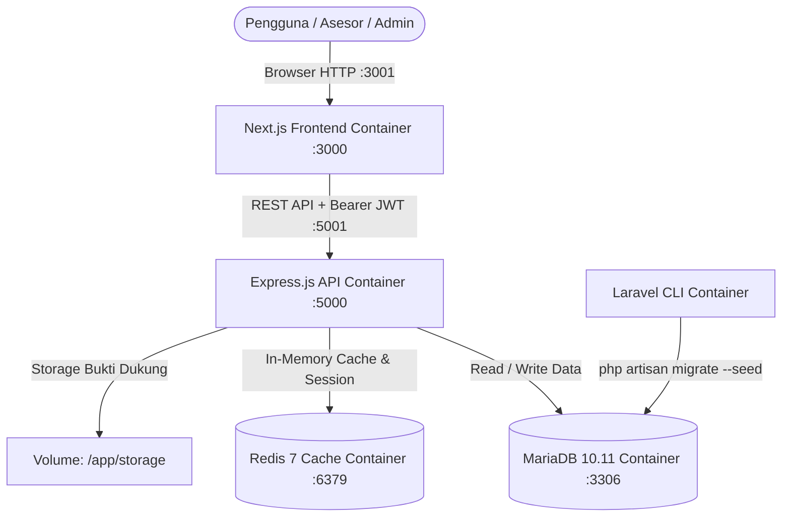

# EVAL-PEMDI: Portal Evaluasi Kinerja Pemerintah Digital
> **Berdasarkan Peraturan Menteri PANRB Nomor 8 Tahun 2026**

Aplikasi portal terpadu untuk evaluasi kematangan Pemerintah Digital (pengganti SPBE PermenPANRB 59/2020) yang mencakup 7 Aspek, 20 Indikator Kematangan (Level 1–5), pengunduhan template bukti dukung resmi, dan perhitungan indeks otomatis secara real-time.

---

## 🏗️ Arsitektur Sistem

Sistem dibangun menggunakan **Arsitektur Modular / Decoupled Berbasis Docker**:



### Komponen Layanan:
1. **Frontend**: Next.js 16 (React 19), Tailwind CSS v4, Lucide Icons.
2. **Backend REST API**: Node.js, Express.js 4.21, JSON Web Token (JWT), Multer file upload.
3. **Database Schema & Seeding Engine**: Laravel 11/12 (PHP 8.2+ Artisan) khusus untuk migrasi DDL dan seeder 20 indikator serta kriteria kematangan.
4. **Database Server**: MariaDB 10.11.
5. **In-Memory Cache**: Redis 7 Alpine.

---

## 📋 7 Aspek & 20 Indikator (PermenPANRB 8/2026)

| No | Aspek | Indikator | Bobot Aspek |
|:---|:---|:---|:---:|
| 1 | **Tata Kelola dan Manajemen** | Indikator 1 - 2 | 10% |
| 2 | **Penyelenggara** | Indikator 3 - 4 | 10% |
| 3 | **Data** | Indikator 5 - 8 | 15% |
| 4 | **Keamanan Pemdi** | Indikator 9 - 12 | 15% |
| 5 | **Teknologi Pemdi** | Indikator 13 - 14 | 10% |
| 6 | **Keterpaduan Layanan Digital** | Indikator 15 - 18 | 15% |
| 7 | **Kepuasan Pengguna** | Indikator 19 - 20 | 25% |

---

## 🚀 Panduan Menjalankan Aplikasi

### 1. Prasyarat
- Docker Desktop & Docker Compose
- Git

### 2. Menjalankan Seluruh Layanan
```bash
docker compose up -d --build
```

### 3. Inisialisasi Database & Seeder
Jalankan migrasi skema dan seeder master data 20 indikator:
```bash
docker compose exec laravel-cli php artisan migrate:fresh --seed
```

### 4. Akses Layanan
- **Frontend Portal**: [http://localhost:3001](http://localhost:3001)
- **Backend API**: [http://localhost:5001/api/v1](http://localhost:5001/api/v1)
- **MariaDB Host Port**: `localhost:3310`
- **Redis Host Port**: `localhost:6381`

---

## 👥 Akun Default (Seeded)

| Role | Email / NIP | Password Default | Akses |
|:---|:---|:---|:---|
| **Admin** | `admin@evalpemdi.go.id` | `password` | Manajemen Master User, Unit Kerja, Template Bukti Dukung |
| **Koordinator** | `koordinator@evalpemdi.go.id` | `password` | Monitoring & Evaluasi Antar Unit |
| **Penilai / Asesor** | `penilai@evalpemdi.go.id` | `password` | Penilaian Mandiri 20 Indikator & Upload Bukti Dukung |

---

## 📄 Lisensi & Regulasi
Aplikasi ini dikembangkan mengacu pada standar resmi instrumen evaluasi **Peraturan Menteri PANRB Nomor 8 Tahun 2026 tentang Evaluasi Kinerja Pemerintah Digital**.
