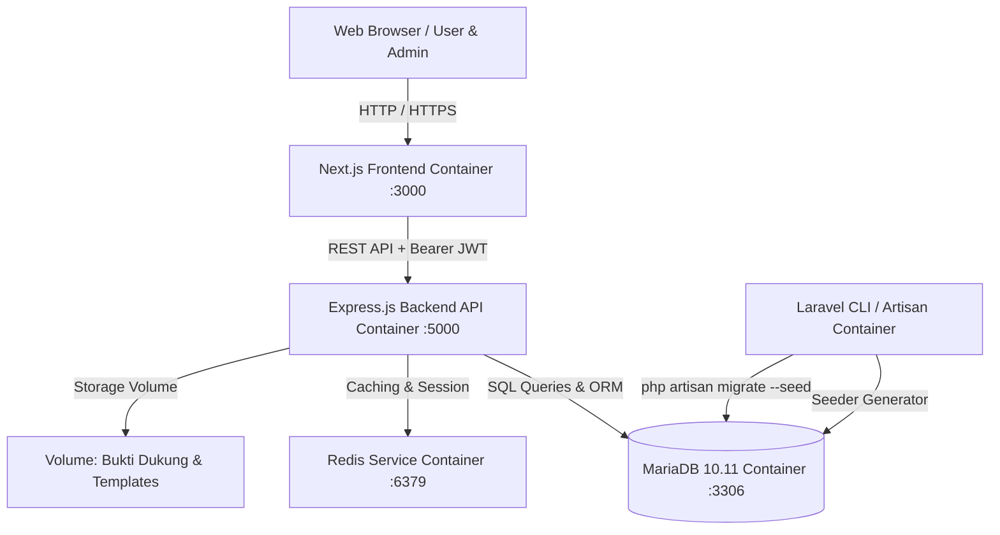
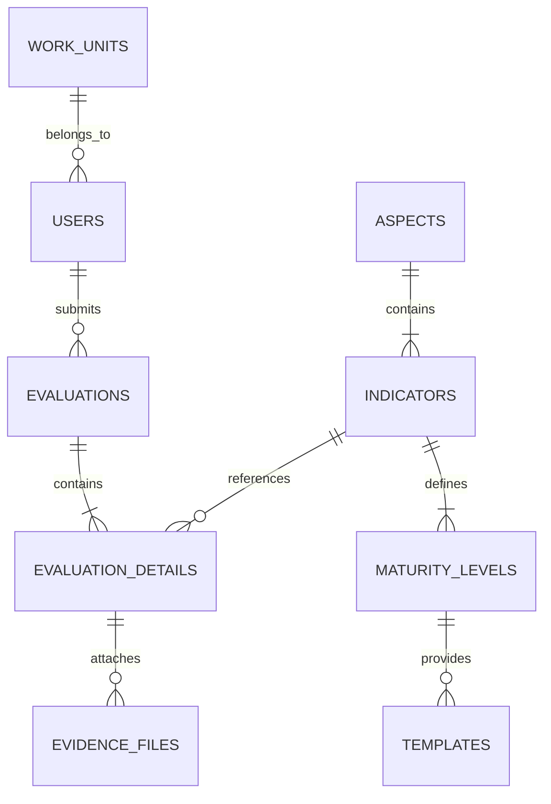

# Rencana Implementasi: Portal Evaluasi Kinerja Pemerintah Digital (EVAL-PEMDI)
**Berdasarkan Peraturan Menteri PANRB Nomor 8 Tahun 2026**

---

## 1. Ringkasan Eksekutif & Landasan Regulasi

### 1.1 Latar Belakang
Sesuai amanat **Peraturan Menteri Pendayagunaan Aparatur Negara dan Reformasi Birokrasi (PANRB) Nomor 8 Tahun 2026 tentang Evaluasi Kinerja Pemerintah Digital**, instrumen pemantauan dan evaluasi sistem pemerintahan berbasis elektronik (SPBE - Permenpan 59/2020) telah resmi bertransformasi menjadi **Evaluasi Kinerja Pemerintah Digital (Pemdi)** yang berorientasi pada *Human-Based Governance*, keterpaduan layanan publik, pemanfaatan AI & data analitik, serta perlindungan data pribadi (PDP).

Aplikasi **EVAL-PEMDI** ini dirancang sebagai portal terpadu untuk:
1. **Admin**: Pengelolaan data master (pengguna, unit kerja/perangkat daerah, master aspek & indikator, serta manajemen template bukti dukung).
2. **Pengguna (Tim Asesor Internal Instansi)**: Pengisian penilaian mandiri 20 indikator, pemilihan level kematangan dengan pratinjau kriteria dinamis, pengunduhan template bukti dukung (.docx / .xlsx), serta pengunggahan file bukti dukung terverifikasi.

---

## 2. Arsitektur Sistem Berbasis Docker (Hybrid Stack)

Proyek ini dibangun di atas arsitektur multi-container Docker dengan pembagian peran yang terpisah secara modular:



### 2.1 Komponen & Peran Teknologi
| Komponen | Teknologi | Peran Utama |
| :--- | :--- | :--- |
| **Database & Schema Runner** | **Laravel (PHP 8.2/8.3 Artisan)** | Mengelola migrasi tabel skema database dan *Database Seeder* komprehensif (20 Indikator, bobot, kriteria, master user, unit kerja, & referensi template). |
| **Backend Core API** | **Express.js (Node.js)** | Menyediakan RESTful API, autentikasi **JWT**, manajemen file upload (Multer), kalkulasi real-time indeks Pemdi, dan integrasi caching **Redis**. |
| **Frontend UI/UX** | **Next.js (React 18/19)** | Dashboard interaktif modern untuk Admin dan Pengguna, penampil dinamis kriteria kematangan, unduhan template, dan uploader bukti dukung. |
| **Database Server** | **MariaDB 10.11+** | Penyimpanan relasional ACID untuk seluruh data master, evaluasi, riwayat skor, dan metadata file. |
| **Cache & Acceleration** | **Redis 7.x** | In-memory cache untuk data indikator, token blacklist, rate-limiting, dan percepatan agregasi skor indeks. |
| **Container Engine** | **Docker & Docker Compose** | Mengorkestrasi seluruh service dalam satu *isolated private network*. |

---

## 3. Desain Skema Database (Laravel Migrations & Seeders)

Perintah `php artisan migrate --seed` pada container Laravel akan mengeksekusi tabel-tabel berikut:

### 3.1 ERD & Struktur Tabel



#### Rincian Tabel:
1. `work_units` (Unit Kerja / Perangkat Daerah)
   - `id`, `name`, `code`, `category` (Pusat/Daerah), `pic_name`, `pic_contact`, `created_at`, `updated_at`.
2. `users`
   - `id`, `work_unit_id` (nullable), `name`, `nip`, `email`, `password`, `role` (`admin`, `koordinator`, `penanggung_jawab`, `pelaksana_entri`, `pelaksana_unit`), `status` (`active`/`inactive`), `created_at`, `updated_at`.
3. `aspects` (7 Aspek Permenpan 8/2026)
   - `id`, `code` (ASPEK_1 .. ASPEK_7), `name`, `weight` (decimal, misal 0.10, 0.15, 0.25), `order_index`.
4. `indicators` (20 Indikator Permenpan 8/2026)
   - `id`, `aspect_id`, `indicator_number` (1..20), `name`, `weight` (decimal, misal 0.05, 0.04), `description`, `supervisor_agency` (Instansi Pembina), `responsible_functions`.
5. `maturity_levels` (Level Kematangan tiap Indikator)
   - `id`, `indicator_id`, `level_number` (1: Kurang, 2: Cukup, 3: Baik, 4: Sangat Baik, 5: Memuaskan), `level_name` (`Kurang/Merintis`, `Cukup/Membangun`, `Baik/Berkembang`, `Sangat Baik/Melembaga`, `Memuaskan/Unggul`), `score_range_min`, `score_range_max`, `criteria_description` (teks lengkap kriteria dari Permenpan).
6. `maturity_templates` (Template Dokumen Bukti Dukung)
   - `id`, `maturity_level_id`, `title`, `document_type` (`docx`, `xlsx`, `pdf`), `file_path`, `description`.
7. `evaluations` (Header Evaluasi Instansi per Tahun)
   - `id`, `work_unit_id`, `evaluator_user_id`, `year`, `final_index_pemdi`, `predicate`, `status` (`draft`, `submitted`, `verified`), `created_at`, `updated_at`.
8. `evaluation_details` (Jawaban Per Indikator)
   - `id`, `evaluation_id`, `indicator_id`, `selected_level_id`, `assessed_score` (1.00 - 5.00), `explanation_notes`, `created_at`, `updated_at`.
9. `evidence_files` (Upload Bukti Dukung Pengguna)
   - `id`, `evaluation_detail_id`, `original_name`, `stored_name`, `mime_type`, `file_size`, `file_url`, `description`, `uploaded_by`, `created_at`.

---

## 4. Struktur 7 Aspek & 20 Indikator Sesuai Permenpan RB No. 8/2026

Berikut rincian indikator dan bobot baku yang akan dimasukkan ke dalam *Database Seeder*:

| No | Aspek (Bobot Aspek) | No Indikator | Nama Indikator | Bobot Indikator | Instansi Pembina |
| :---: | :--- | :---: | :--- | :---: | :--- |
| **1** | **Tata Kelola dan Manajemen (10%)** | 1 | Tingkat Kematangan Tata Kelola Pemdi | 5% | KemenPANRB, Komdigi, Bappenas, BSSN |
| | | 2 | Tingkat Kematangan Manajemen Layanan Digital Pemerintah | 5% | KemenPANRB, Bappenas, BSSN, BRIN, BPKP |
| **2** | **Penyelenggara (10%)** | 3 | Tingkat Kematangan Sumber Daya Manusia Pemdi | 5% | KemenPANRB, Komdigi, Kemendagri, BKN, LAN |
| | | 4 | Tingkat Kematangan Kolaborasi Pemdi | 5% | KemenPANRB, Kemendagri |
| **3** | **Data (15%)** | 5 | Tingkat Kematangan Tata Kelola Data | 5% | Bappenas (Satu Data Indonesia) |
| | | 6 | Tingkat Kematangan Penyelenggaraan Informasi Geospasial | 3% | BIG (Badan Informasi Geospasial) |
| | | 7 | Tingkat Kematangan Pembangunan Statistik | 3% | BPS (Badan Pusat Statistik) |
| | | 8 | Tingkat Kematangan Pelindungan Data Pribadi | 4% | Kementerian Komunikasi dan Digital |
| **4** | **Keamanan Pemdi (15%)** | 9 | Tingkat Kematangan Pelaksanaan Audit Keamanan Pemdi & Teknologi | 4% | BSSN (Badan Siber & Sandi Negara) |
| | | 10 | Tingkat Kematangan Keamanan Pemdi (IKASANDI) | 4% | BSSN |
| | | 11 | Tingkat Kematangan Penerapan Kriptografi untuk Keamanan Data | 3% | BSSN |
| | | 12 | Tingkat Kematangan Kapabilitas Penanganan Insiden Siber (CSIRT) | 4% | BSSN |
| **5** | **Teknologi Pemdi (10%)** | 13 | Tingkat Kematangan Aplikasi Pemdi (SDLC & Integrasi) | 5% | Kementerian Komunikasi dan Digital |
| | | 14 | Tingkat Kematangan Infrastruktur Pemdi (Cloud & PDN) | 5% | Kementerian Komunikasi dan Digital |
| **6** | **Keterpaduan Layanan Digital (15%)** | 15 | Keterpaduan Proses Bisnis Pemdi Lintas Unit dan Instansi | 4% | KemenPANRB, Bappenas, Kemendagri, ANRI |
| | | 16 | Integrasi Aplikasi (Dasbor Presiden & Layanan Publik) | 4% | Kementerian Komunikasi dan Digital |
| | | 17 | Portal Layanan Digital Pemerintah (SSO/Portal Nasional) | 4% | Komdigi, BSSN |
| | | 18 | Interoperabilitas Data | 3% | Bappenas |
| **7** | **Kepuasan Pengguna (25%)** | 19 | Fasilitas Dukungan Pengguna Layanan Digital (SLA & Helpdesk) | 10% | KemenPANRB |
| | | 20 | Tingkat Pengelolaan Kepuasan Pengguna Layanan Digital | 15% | KemenPANRB |

### 4.1 Rumus Perhitungan Indeks (Sesuai Bab II Hal. 36-38)
1. **Indeks Aspek ke-$i$**:
   $$\text{Indeks Aspek}_i = \frac{\sum_{j=1}^{n} (wI_j \times NI_j)}{wA_i}$$
2. **Indeks Pemdi Total**:
   $$\text{Indeks Pemdi} = \sum_{i=1}^{7} (w\text{Aspek}_i \times N\text{Aspek}_i) = \sum_{k=1}^{20} (wI_k \times NI_k)$$
3. **Predikat Indeks**:
   - $1.00 \le \text{Indeks} \le 1.50$ : **Kurang / Merintis / Initiate**
   - $1.50 < \text{Indeks} \le 2.50$ : **Cukup / Membangun / Emerging**
   - $2.50 < \text{Indeks} \le 3.50$ : **Baik / Berkembang / Developing**
   - $3.50 < \text{Indeks} \le 4.00$ : **Sangat Baik / Melembaga / Embedded**
   - $4.00 < \text{Indeks} \le 5.00$ : **Memuaskan / Unggul / Leading**

---

## 5. Fitur & Alur Kerja Halaman (Admin vs Pengguna)

### 5.1 Halaman Admin
- **Dashboard Statistik**: Total instansi/unit terdaftar, status pengisian penilaian mandiri, sebaran skor per aspek.
- **Manajemen Master User**: CRUD data user, penugasan unit kerja, dan penetapan role (`Admin`, `Koordinator`, `Penanggung Jawab`, `Pelaksana`).
- **Manajemen Master Unit Kerja**: Tambah/edit nama dinas/badan/bagian dan kode organisasi.
- **Manajemen Indikator & Kriteria**: Meninjau/memperbarui deskripsi kriteria level kematangan 20 indikator.
- **Manajemen Template Bukti Dukung**: Mengunggah file template resmi format Word (`.docx`) dan Excel (`.xlsx`) untuk setiap level indikator yang dapat langsung diunduh pengguna.

### 5.2 Halaman Pengguna (Evaluasi Mandiri)
- **Seleksi 20 Indikator Berbasis Akordeon / Tab Aspek**: Tampilan tertata menurut 7 aspek utama.
- **Pemilihan Level Kematangan Interaktif**:
  - Pilihan level: *Cukup*, *Baik*, *Sangat Baik*, *Memuaskan* (serta opsi *Kurang/Merintis*).
  - Ketika sebuah level dipilih:
    1. **Teks Kriteria Kematangan** langsung muncul sesuai regulasi Permenpan 8/2026.
    2. **Daftar Template Bukti Dukung** ditampilkan lengkap dengan tombol unduh langsung (`.docx` / `.xlsx`).
- **Uploader Bukti Dukung**:
  - Form upload file (mendukung `.pdf`, `.docx`, `.xlsx`, max 25MB per file).
  - Kolom deskripsi/catatan penjelasan data dukung.
  - Tabel daftar file bukti yang telah diunggah dengan opsi preview dan hapus.
- **Live Score Preview (Simulasi Indeks)**:
  - Pratinjau nilai indeks aspek dan nilai total indeks Pemdi secara instan dengan label predikat (badge berwarna).

---

## 6. Spesifikasi Backend Express.js API + Redis + JWT

### 6.1 Endpoint Utama
- `POST /api/v1/auth/login` : Login user & penerbitan token JWT.
- `GET /api/v1/auth/me` : Validasi token & data profil user login.
- `GET /api/v1/master/aspects` : Mengambil daftar 7 aspek & 20 indikator (dicache via Redis).
- `GET /api/v1/indicators/:id/levels` : Mengambil kriteria & template dokumen per level indikator.
- `GET /api/v1/evaluations/current` : Mengambil sesi evaluasi aktif instansi pengguna.
- `POST /api/v1/evaluations/save-answer` : Menyimpan pilihan level indikator dan catatan penjelasan.
- `POST /api/v1/evaluations/upload-evidence` : Mengunggah file bukti dukung menggunakan Multer.
- `DELETE /api/v1/evaluations/evidence/:id` : Menghapus bukti dukung yang salah upload.
- `GET /api/v1/evaluations/calculate-score` : Kalkulasi skor indeks aspek & indeks total.
- `POST /api/v1/evaluations/submit` : Finalisasi pengiriman penilaian mandiri ke tahap verifikasi.

### 6.2 Redis Optimization
- Key `pemdi:aspects:all` : Cache struktur indikator dan kriteria (TTL: 24 jam / di-invalidate jika admin mengubah data).
- Key `pemdi:eval_score:{eval_id}` : Cache skor kalkulasi evaluasi yang sedang aktif.
- Key `pemdi:blacklist_token:{jti}` : Revocation blacklist JWT saat logout.

---

## 7. Rencana Struktur Direktori Proyek

```plaintext
EVALPEMDI2/
├── docker-compose.yml              # Multi-container orchestration
├── .env.example
├── README.md
├── pemdi_planning1.md              # Dokumen perencanaan ini
│
├── laravel-db/                     # Laravel 11/12 (Schema & Seeders)
│   ├── Dockerfile
│   ├── composer.json
│   ├── artisan
│   └── database/
│       ├── migrations/             # Skema tabel pemdi
│       │   ├── 2026_01_01_000001_create_work_units_table.php
│       │   ├── 2026_01_01_000002_create_users_table.php
│       │   ├── 2026_01_01_000003_create_aspects_and_indicators_table.php
│       │   ├── 2026_01_01_000004_create_maturity_levels_and_templates_table.php
│       │   └── 2026_01_01_000005_create_evaluations_and_evidences_table.php
│       └── seeders/                # Seeder 20 Indikator Permenpan 8/2026
│           ├── DatabaseSeeder.php
│           ├── WorkUnitSeeder.php
│           ├── UserSeeder.php
│           ├── AspectIndicatorSeeder.php
│           └── MaturityLevelCriteriaSeeder.php
│
├── express-api/                    # Node.js Express Backend API
│   ├── Dockerfile
│   ├── package.json
│   ├── src/
│   │   ├── server.js
│   │   ├── config/ (db.js, redis.js, jwt.js)
│   │   ├── middlewares/ (auth.js, role.js, upload.js)
│   │   ├── controllers/ (authController.js, indicatorController.js, evaluationController.js, adminController.js)
│   │   ├── routes/ (api.js)
│   │   └── utils/ (scoreCalculator.js)
│   └── storage/
│       ├── templates/              # File template master .docx & .xlsx
│       └── evidences/              # File upload dari pengguna
│
└── nextjs-frontend/                # Next.js UI Application
    ├── Dockerfile
    ├── package.json
    ├── tailwind.config.js
    ├── src/
    │   ├── app/
    │   │   ├── (auth)/login/page.js
    │   │   ├── admin/
    │   │   │   ├── dashboard/page.js
    │   │   │   ├── master-users/page.js
    │   │   │   ├── master-units/page.js
    │   │   │   └── templates/page.js
    │   │   └── user/
    │   │       ├── dashboard/page.js
    │   │       └── evaluasi/page.js # Form 20 Indikator, kriteria dinamis, upload
    │   ├── components/
    │   │   ├── Navbar.js
    │   │   ├── IndicatorCard.js
    │   │   ├── MaturitySelector.js
    │   │   ├── TemplateDownloader.js
    │   │   ├── EvidenceUploader.js
    │   │   └── ScoreCard.js
    │   └── services/ (api.js, authService.js, evalService.js)
```

---

## 8. Blueprint Konfigurasi Docker Compose (`docker-compose.yml`)

```yaml
version: '3.8'

services:
  mariadb:
    image: mariadb:10.11
    container_name: evalpemdi_mariadb
    restart: always
    environment:
      MYSQL_ROOT_PASSWORD: rootsecretpassword
      MYSQL_DATABASE: evalpemdi_db
      MYSQL_USER: evalpemdi_user
      MYSQL_PASSWORD: evalpemdi_password
    ports:
      - "3306:3306"
    volumes:
      - mariadb_data:/var/lib/mysql
    networks:
      - evalpemdi_net

  redis:
    image: redis:7-alpine
    container_name: evalpemdi_redis
    restart: always
    ports:
      - "6379:6379"
    command: ["redis-server", "--appendonly", "yes"]
    volumes:
      - redis_data:/data
    networks:
      - evalpemdi_net

  laravel-cli:
    build:
      context: ./laravel-db
      dockerfile: Dockerfile
    container_name: evalpemdi_laravel_cli
    depends_on:
      - mariadb
    volumes:
      - ./laravel-db:/var/www/html
    environment:
      DB_HOST: mariadb
      DB_DATABASE: evalpemdi_db
      DB_USERNAME: evalpemdi_user
      DB_PASSWORD: evalpemdi_password
    networks:
      - evalpemdi_net

  express-api:
    build:
      context: ./express-api
      dockerfile: Dockerfile
    container_name: evalpemdi_express_api
    restart: always
    depends_on:
      - mariadb
      - redis
    environment:
      PORT: 5000
      DB_HOST: mariadb
      DB_NAME: evalpemdi_db
      DB_USER: evalpemdi_user
      DB_PASSWORD: evalpemdi_password
      REDIS_HOST: redis
      REDIS_PORT: 6379
      JWT_SECRET: super_jwt_secret_pemdi_2026
    ports:
      - "5000:5000"
    volumes:
      - ./express-api/storage:/app/storage
    networks:
      - evalpemdi_net

  nextjs-frontend:
    build:
      context: ./nextjs-frontend
      dockerfile: Dockerfile
    container_name: evalpemdi_nextjs_ui
    restart: always
    depends_on:
      - express-api
    ports:
      - "3000:3000"
    environment:
      NEXT_PUBLIC_API_URL: http://localhost:5000/api/v1
    networks:
      - evalpemdi_net

networks:
  evalpemdi_net:
    driver: bridge

volumes:
  mariadb_data:
  redis_data:
```

---

## 9. Rencana Tahapan Eksekusi (Roadmap)

### Fase 1: Fondasi Docker, Database & Laravel Seeders
- [ ] Inisialisasi struktur folder proyek & file konfigurasi `.env`.
- [ ] Pembuatan `docker-compose.yml` untuk MariaDB, Redis, Laravel, Express, dan Next.js.
- [ ] Implementasi Migration Laravel untuk 9 tabel inti.
- [ ] Pembuatan Database Seeder Laravel yang memuat 7 aspek, 20 indikator, seluruh teks kriteria dari Permenpan RB No. 8/2026, akun default admin & user contoh.
- [ ] Validasi migrasi: `docker compose run --rm laravel-cli php artisan migrate --seed`.

### Fase 2: Backend Express.js API, JWT & Redis
- [ ] Setup Express.js server, koneksi database MariaDB (MySQL2/Sequelize), dan Redis Client.
- [ ] Implementasi modul Autentikasi (JWT + middleware proteksi role Admin vs User).
- [ ] Implementasi endpoints Master Data (Aspek, Indikator, Level Kematangan, Template File).
- [ ] Implementasi Multer untuk upload dokumen bukti dukung (`.pdf`, `.docx`, `.xlsx`).
- [ ] Implementasi engine kalkulasi rumus skor Indeks Aspek dan Indeks Pemdi.

### Fase 3: Frontend Next.js (Admin & Portal Pengguna)
- [ ] Setup Next.js App Router dengan styling modern, responsif, dan elegan.
- [ ] Halaman Login & session management via JWT.
- [ ] **Portal Admin**: CRUD Pengguna, Manajemen Unit Kerja, dan Upload Master Template Bukti Dukung.
- [ ] **Portal Pengguna**:
  - Tampilan interaktif 20 Indikator Evaluasi Pemdi.
  - Seleksi level kematangan (*Cukup*, *Baik*, *Sangat Baik*, *Memuaskan*).
  - Penampil dinamis teks kriteria regulasi saat level diklik.
  - Tautan unduh template file dokumen bukti dukung (`.docx` / `.xlsx`).
  - Komponen upload file bukti dukung dengan indikator progress dan daftar berkas terunggah.
  - Widget simulasi skor real-time dengan status predikat.

### Fase 4: Pengujian Komprehensif & Penyempurnaan
- [ ] Pengujian fungsional seluruh 20 indikator dan kelengkapan bukti dukung.
- [ ] Pengujian kalkulasi matematis indeks sesuai contoh pada Bab II Permenpan 8/2026 (skor 1.00 s/d 5.00).
- [ ] Uji coba caching Redis untuk respon API berkecepatan tinggi.

---

> [!NOTE]
> File perencanaan ini disiapkan untuk dieksekusi secara bertahap. Seluruh data kriteria dan bobot mengacu penuh pada Salinan Resmi Peraturan Menteri PANRB Nomor 8 Tahun 2026.
